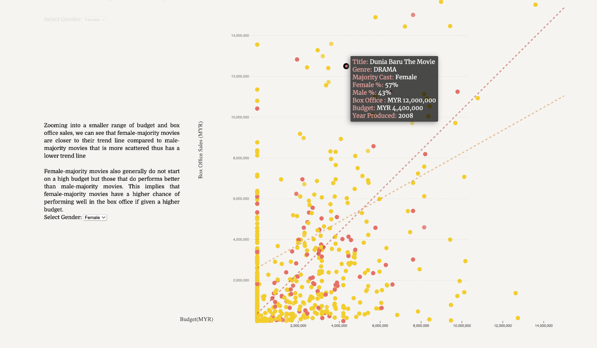
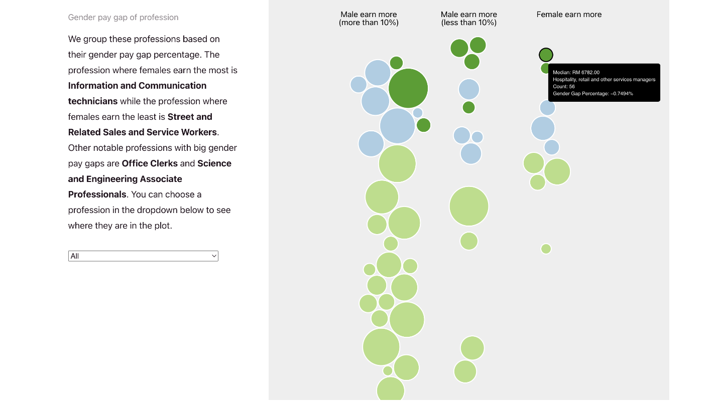
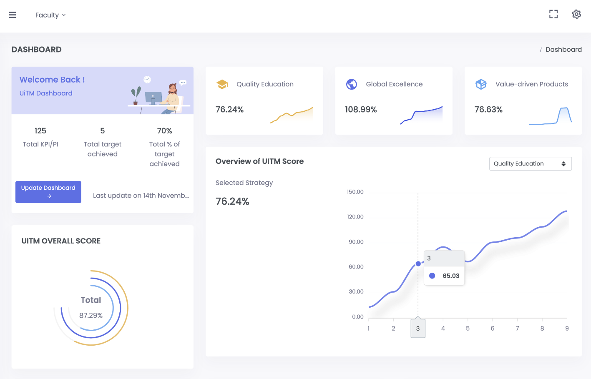

<section class="cv-section">
  <h2>Experience</h2>
  

    <article>
      

        <h3>Data Scientist</h3>
        
KESTRL Tech Sdn. Bhd.

        
Selangor

      

      

        <ul>
          <li>Developed a machine learning predictive model as part of an MLOps pipeline to predict categories of bank account transactions.</li>
          <li>Developed an automated data crawler to extract data from relevant websites.</li>
          <li>Developed a dashboard to extract data from various sources, updated daily, and created visualizations so stakeholders can monitor product performance.</li>
        </ul>
        
Tech: Python, AWS Lambda, PostgreSQL

      

          
Sept 2020 – current

    </article>
    <article>
      

        <h3>Software Developer</h3>
        
Arche Information

        
Tokyo

      

      

        <ul>
          <li>Led development of a mobile reservation app connecting salons with customers, built for the Myanmar market.</li>
          <li>Developed an e-commerce web app for a beauty product distributor in Japan.</li>
          <li>Developed a prototype voice-command application for a car manufacturer in Japan.</li>
          <li>Did research and development for an automated robot system that sorts and delivers items in e-commerce warehouses.</li>
        </ul>
        
Tech: Swift, Ruby on Rails, Java Struts

      

          
Sept 2016 – Apr 2019

    </article>
    <article>
      

        <h3>IT Intern</h3>
        
Time Dotcom

        
Shah Alam

      

      

        <ul>
          <li>Involved in application design and development.</li>
        </ul>
        
Tech: Java Spring, PrimeFaces

      

          
Apr 2016 – Jul 2016

    </article>
    <article>
      

        <h3>Teaching Assistant</h3>
        
IIUM, Gombak

      

      

        <ul>
          <li>Assisted in facilitating lab sessions for Introduction to Programming.</li>
        </ul>
        
Tech: C++

      

          
Feb 2016 – Dec 2016

    </article>
    <article>
      

        <h3>Freelance</h3>
        
IIUM, Gombak

      

      

        <ul>
          <li>Research assistant</li>
          <li>Website development</li>
          <li>Content writing</li>
          <li>Poster design</li>
          <li>Transcribing</li>
          <li>Data entry</li>
        </ul>
      

    </article>
    <article>
      

        <h3>IT Intern</h3>
        
Kreydle

        
Petaling Jaya

      

      

        <ul>
          <li>Involved in WordPress plugin development.</li>
        </ul>
        
Tech: WordPress, PHP

      

          
Feb 2016 – Mar 2016

    </article>
  

</section>

<section class="cv-section">
  <h2>Education</h2>
  

    <article>
      

        <h3>MSc Data Science</h3>
      

      

        
Universiti Teknologi MARA (UiTM)

CGPA 3.9/4.0

      

          
2021

    </article>
    <article>
      

        <h3>BSc Computer Science</h3>
      

      

        
International Islamic University Malaysia (IIUM)

CGPA 3.6/4.0

First class honours

Valedictorian

      

          
2016

    </article>
  

</section>

<section class="cv-section">
  <h2>Skills</h2>
  

    

      <h3>Languages</h3>
      <ul class="skills">
        <li>Python</li>
        <li>R</li>
        <li>Laravel</li>
        <li>Java</li>
        <li>C++</li>
        <li>Ruby on Rails</li>
        <li>MySQL</li>
        <li>D3.js</li>
      </ul>
    

    

      <h3>Tools</h3>
      <ul class="skills">
        <li>AWS Lambda</li>
        <li>SPSS Modeler</li>
        <li>SPSS Statistics</li>
        <li>SAS Enterprise Miner</li>
        <li>Adobe Illustrator</li>
        <li>Xcode</li>
        <li>Tableau</li>
        <li>Power BI</li>
        <li>Plotly Dash</li>
      </ul>
    

  

</section>

<section class="cv-section">
  <h2>Achievements</h2>
  

    <article>
      

        <h3>Best Student KICT (Overall)</h3>
      

      

        
Graduation class of 2016

      

          
2016

    </article>
    <article>
      

        <h3>Scholarship Recipient</h3>
      

      

        
Yayasan Bank Rakyat

MSc Data Science

      

          
2019/ 2020

    </article>
    <article>
      

        <h3>Competitive Programming</h3>
      

      

        
ACM-ICPC

University and national level

      

          
2015/ 2016

    </article>
    <article>
      

        <h3>Dean’s list</h3>
      

      

        
5 semesters

      

          
2012/ 2016

    </article>
    <article>
      

        <h3>Community Service</h3>
      

      

        
Bronze

      

          
2015

    </article>
  

</section>

<section class="cv-section">
  <h2>Certificates</h2>
  

    <article>
      

        <h3>Machine Learning Professional</h3>
      

      

        
RapidMiner

      

          
2020

    </article>
    <article>
      

        <h3>Application &amp; Use Case Professional</h3>
      

      

        
RapidMiner

      

          
2020

    </article>
  

</section>

<section class="cv-section projects">
  <h2>Projects</h2>
  

    <h3 class="group">Machine Learning</h3>
    <article>
      

        <h3 class="plain">Predicting category of a bank account transaction</h3>
      

      

        
An NLP multi-class classification project using text embedding and feature engineering to predict the category of a bank account transaction from its description.

        <dl class="facts">
          
<dt>Data</dt><dd>UK open banking data</dd>

          
<dt>Tools</dt><dd>Python, fastText, sklearn</dd>

          
<dt>Models</dt><dd>SVC, neural network, XGBoost, logistic regression, extra trees</dd>

        </dl>
      

    </article>
    <article>
      

        <h3 class="plain">Predicting the success of a bank telemarketing campaign</h3>
      

      

        
A binary classification project using feature engineering to predict whether a telemarketing campaign will succeed with a specific customer.

        <dl class="facts">
          
<dt>Data</dt><dd>Kaggle</dd>

          
<dt>Tools</dt><dd>SPSS Modeler</dd>

          
<dt>Models</dt><dd>Logistic regression, decision tree, neural network, SVM</dd>

        </dl>
      

    </article>
    <article>
      

        <h3 class="plain">Customer segmentation for targeted marketing</h3>
      

      

        
A clustering project using k-means and principal component analysis to identify customer groups for different marketing strategies.

        <dl class="facts">
          
<dt>Data</dt><dd>Kaggle</dd>

          
<dt>Tools</dt><dd>Python, sklearn</dd>

          
<dt>Models</dt><dd>k-means, PCA</dd>

        </dl>
      

    </article>
    <h3 class="group">Data Visualization</h3>
    <article>
      

        <h3 class="plain">Visualizing Malaysian Cinema in the 21st Century</h3>
        <figure class="project-shot">
          
        </figure>
      

      

        
A visual essay on Malaysian movies, distinguishing films with a female-majority cast from the rest.

        <dl class="facts">
          
<dt>Data</dt><dd>Scraped from the FINAS website</dd>

          
<dt>Tools</dt><dd>D3.js</dd>

          
<dt>Website</dt><dd><a href="https://naelah.github.io/visualizing-malay-cinema/">naelah.github.io/visualizing-malay-cinema</a></dd>

        </dl>
      

    </article>
    <article>
      

        <h3 class="plain">The Malaysian Dream: Exploring the Gender Gap</h3>
        <figure class="project-shot">
          
        </figure>
      

      

        
A visual essay exploring the gender gap amongst Malaysians.

        <dl class="facts">
          
<dt>Data</dt><dd>DOSM 2019 salaries and wages</dd>

          
<dt>Tools</dt><dd>D3.js</dd>

          
<dt>Website</dt><dd><a href="https://naelah.github.io/gender-gap/">naelah.github.io/gender-gap</a></dd>

        </dl>
      

    </article>
    <article>
      

        <h3 class="plain">KPI Tracker Dashboard</h3>
        <figure class="project-shot">
          
        </figure>
      

      

        
A dashboard that gives stakeholders a quick view of progress against KPI targets.

        <dl class="facts">
          
<dt>Data</dt><dd>UiTM internal data</dd>

          
<dt>Tools</dt><dd>React</dd>

        </dl>
      

    </article>
  

</section>

<section class="cv-section">
  <h2>Publications</h2>
  

    <article>
      

        <h3>Journal</h3>
      

      

        
<strong>Gender Representation of 20 years Malaysian Films based on Andy Kirk Dynamic Visualization Framework</strong>

        
Mathematical Sciences and Informatics Journal, [S.l.], p. 15-25, nov. 2021. ISSN 2735-0703. Available at: <a href="https://myjms.mohe.gov.my/index.php/mij/article/view/13909">https://myjms.mohe.gov.my/index.php/mij/article/view/13909</a>. doi: <a href="https://doi.org/10.24191/mij.v2i2.13909">https://doi.org/10.24191/mij.v2i2.13909</a>.

      

          
2020

    </article>
  

</section>
